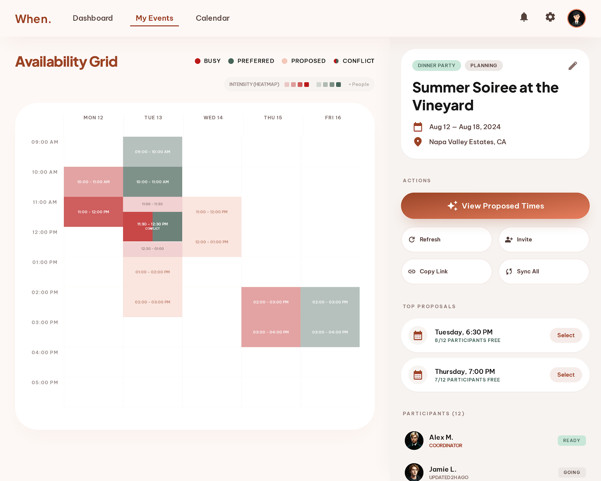
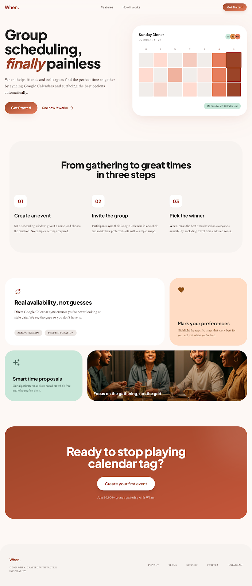
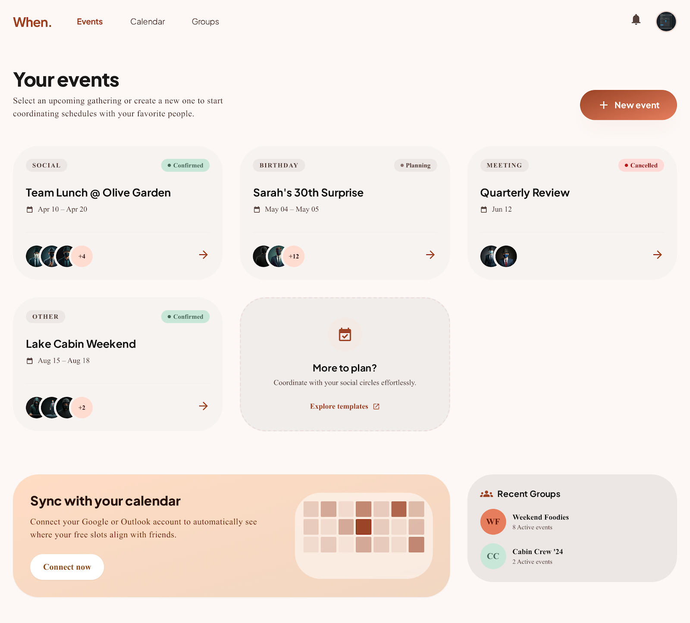
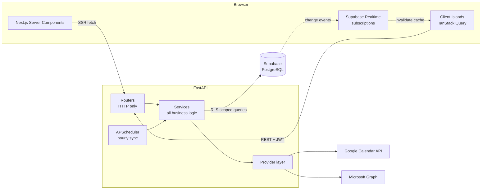

<div align="center">

# When.

**Group scheduling without the back-and-forth.**

Invite people, sync their Google or Outlook calendars, and get the best meeting time ranked by real availability and stated preferences. Once the coordinator confirms, the event is written straight onto everyone's calendar.

### [🔗 Live demo: when-now.com](https://when-now.com)




</div>

---

## Why I built it

Finding a time that works for five people usually takes a dozen messages and a lot of calendar-tab switching. When. replaces that with one link. Participants connect their calendar, optionally mark the times they'd prefer, and the app shows the coordinator the best options.

I designed and built the whole system myself, from database schema and backend to frontend and deployment. This is **v2**, a ground-up rewrite of my first version. The biggest change was replacing the original LLM-based (Gemini) scheduler with a **deterministic, fully tested algorithm**. It gives the same output for the same input, explains every ranking, and has no API cost or latency.

## Highlights

| | |
|---|---|
| 📅 **Multi-provider calendar sync** | Google Calendar and Microsoft Outlook (Graph API) behind a shared provider abstraction. Users can connect several accounts across both providers. Busy times sync when an account is connected and then hourly in the background. |
| 🧮 **Deterministic scheduling engine** | Generates candidate windows inside each day's allowed hours (including overnight windows that cross midnight). It never proposes past times, ranks by conflicts and then preference overlap, and returns the top 5 with a readable reason for each. |
| ⚡ **Real-time collaboration** | Supabase Realtime pushes participant changes, calendar syncs and proposal refreshes to every open screen. Mutations update optimistically, so the grid never waits on a spinner. |
| ✍️ **Cross-provider write-back** | On finalization the event is created on **each participant's own calendar** with their own credentials, whether they use Google or Microsoft. A database trigger enforces exactly one write calendar per user. Participants without a connected calendar get an emailed invite instead. |
| 🔐 **Security by default** | Row Level Security on every user-facing table. Privileged access is limited to specific services. OAuth tokens are stored server-side and revoked on account deletion. Expired credentials are detected and the user is asked to reconnect without affecting other participants. |
| 🧪 **Tested and documented** | 450+ automated tests (pytest and Vitest), plus integration tests that check RLS against a live database. Architecture, data model and per-sprint lessons are written up in [`docs/`](docs/). |

## Screenshots

<table>
  <tr>
    <td width="50%"><br/><sub><b>Landing</b>: hero with an availability-grid preview</sub></td>
    <td width="50%"><br/><sub><b>Dashboard</b>: event cards and calendar-connect prompt</sub></td>
  </tr>
</table>

## Architecture



**Design decisions**

- **Thin routers, fat services.** Routers only parse input and shape responses. All logic lives in stateless, unit-testable services.
- **Provider abstraction.** Each calendar provider implements one `CalendarProvider` interface for OAuth, listing calendars, reading busy times and creating events. Adding a provider doesn't touch the sync, connect or finalize flows. The interface also handles the differences between providers: Microsoft rotates refresh tokens on every refresh and Google doesn't.
- **Realtime is a signal, not a source of truth.** Realtime events only invalidate TanStack Query caches. The client always re-fetches authoritative data from the API.
- **Server-first rendering.** Event pages are fetched on the server, so they arrive fully populated with no loading skeletons. Client islands then hydrate and subscribe to live updates.
- **UTC everywhere.** All times are stored and computed in UTC and converted only at the display layer.

## The scheduling algorithm

```
1. Generate   Slide a window of the event's duration across the date range in 30-min steps,
              keeping only windows that fall inside each day's allowed hours (which may cross
              midnight) and that start in the future.
2. Score      conflicts = participants with a busy slot overlapping the window
              preferred = participants with a preferred slot overlapping the window
3. Rank       ORDER BY conflicts ASC, preferred DESC, start time ASC
4. Explain    "3/4 participants marked this time as preferred, 0/4 have a conflict"
5. Persist    Store the top 5. Regenerate only when inputs change (stale-flag pattern).
```

Full details in [`docs/ARCHITECTURE.md`](docs/ARCHITECTURE.md#scheduling-algorithm-proposal_servicepy).

## Tech stack

| Layer | Technologies |
|---|---|
| **Frontend** | Next.js 14 (App Router) · TypeScript · TanStack Query · Zustand · React Hook Form + Zod · shadcn/ui · Tailwind CSS |
| **Backend** | Python 3.12 · FastAPI · Pydantic v2 · APScheduler |
| **Data** | Supabase (PostgreSQL, Row Level Security, Realtime, triggers) |
| **Integrations** | Google OAuth 2.0 & Calendar API · Microsoft Graph (MSAL) |
| **Testing** | pytest · Vitest · Testing Library · RLS integration tests |
| **Infra** | Docker · Docker Compose |

## How it was built

- **Planned in sprints.** Each feature area (auth → events → invitations → calendar sync → availability → proposals → finalization) was planned up front in [`docs/SPRINT_PLAN.md`](docs/SPRINT_PLAN.md) and delivered as its own sprint.
- **Test-driven.** Tests were written alongside each sprint. External APIs are mocked and no unit test touches a real database.
- **Documentation as the source of truth.** [`DATA_MODEL.md`](docs/DATA_MODEL.md) and [`ARCHITECTURE.md`](docs/ARCHITECTURE.md) define the system. [`LESSONS_LEARNED.md`](docs/LESSONS_LEARNED.md) records the non-obvious things learned in each sprint.

## Run it locally

```bash
git clone https://github.com/yonid4/when-V2.git && cd when-V2
cp backend/.env.example backend/.env      # Supabase + Google OAuth keys
cp frontend/.env.example frontend/.env    # public Supabase keys
docker compose up --build                 # → http://localhost:3000
```

You'll need a Supabase project (run [`schema.sql`](schema.sql) once) and Google OAuth credentials. Outlook support is optional.
**👉 Full step-by-step instructions: [`docs/SETUP.md`](docs/SETUP.md)**

## Documentation

| Doc | What's inside |
|---|---|
| [`SETUP.md`](docs/SETUP.md) | Local setup, OAuth configuration, environment variables, tests |
| [`ARCHITECTURE.md`](docs/ARCHITECTURE.md) | System overview, folder structure, data flows, scheduling algorithm |
| [`DATA_MODEL.md`](docs/DATA_MODEL.md) | Tables, relationships, RLS policies, triggers |
| [`TECH_STACK.md`](docs/TECH_STACK.md) | Tool choices and constraints |
| [`TESTS.md`](docs/TESTS.md) | Test inventory and strategy |
| [`LESSONS_LEARNED.md`](docs/LESSONS_LEARNED.md) | Gotchas and insights from each sprint |

## License

[MIT](LICENSE) © Yonatan Dayagi
