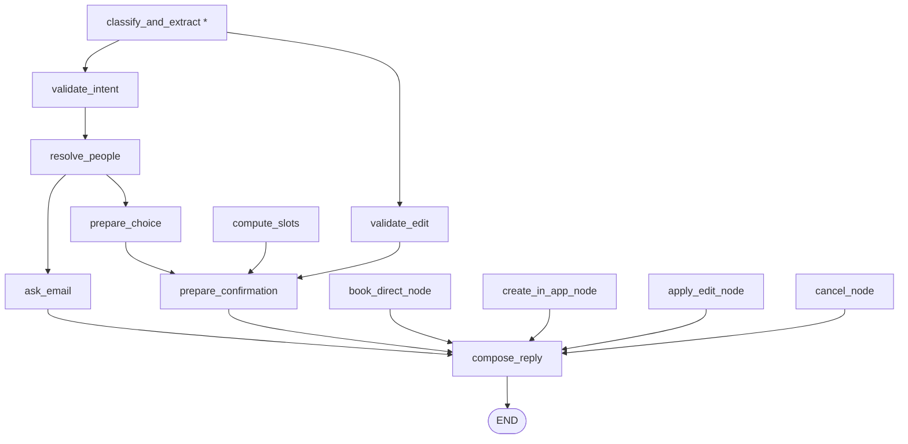

# agent_service — the When. chat agent

A standalone LangGraph package that powers the agentic chat drawer. It turns a
user's free-text message (or a structured button tap) into a deterministic
scheduling workflow: creating events, booking them directly onto calendars,
or editing an existing event.

The package lives next to `app/` inside `backend/` and is imported as a
top-level package (`from agent_service import graph`). Its single consumer is
`app/services/chat_service.py`, which runs one graph turn per request.

## Design principles

- **Deterministic routing.** The graph is a `StateGraph(AgentState)` whose
  every conditional edge is a plain Python lookup (`state['route']`). The LLM
  never decides control flow, never selects a slot, and never writes anything.
- **LLM confined to a single call.** `classify_and_extract` (intent + field
  extraction) is the only LLM node — it also attributes emails to the people it
  lists, so name↔email pairing needs no separate round-trip. Everything else,
  `resolve_people` included, is pure deterministic logic — including
  `compose_reply`, which renders a fact-complete template per outcome
  (structured-action turns are 0-LLM).
- **Thinking disabled.** The model factory passes `thinking_budget=0` — the
  agent's call is a simple extraction task that gains nothing from Gemini 2.5
  Flash's default dynamic thinking, which adds seconds per call. Keep
  `GEMINI_MODEL` on a Flash-tier model (Pro cannot disable thinking).
- **Security boundary at the entry router.** An event is only ever created,
  booked, or edited when the entry router dispatches a *structured action*
  (`confirm_draft` / `book_direct` / `use_in_app` / `cancel`) from a matching
  waiting state. Free text always routes to `classify_and_extract` first and
  can never reach a write node.
- **Stateless graph.** Each turn rehydrates workflow state from the
  `chat_threads` row, advances it, and `chat_service` writes it back. The graph
  itself holds no memory and never reads the wall clock —
  `reference_time_utc` is injected by the router.
- **An LLM failure never kills a turn.** `chat_service` persists the user's
  message *before* invoking the graph, so an exception escaping a node would
  strand that message with no assistant reply and an unadvanced thread. The lone
  LLM call, `classify_and_extract`, degrades instead: it retries once and then
  falls back to an apology reply rather than raising.

## Module map

| Module | Role |
| --- | --- |
| `graph.py` | Graph construction + entry router. Exposes `get_compiled_graph()` (module-cached, real Gemini) and `build_graph(llm)` (tests inject a fake). |
| `state.py` | `AgentState` TypedDict — per-turn injected facts, rehydrated thread state, and turn outputs. |
| `nodes.py` | Create-workflow + shared nodes (validation, drafting, confirmation cards, booking dispatch). |
| `editing.py` | Edit-workflow nodes: `validate_edit` (before/after change set) and `apply_edit_node`. |
| `people.py` | Participant resolution (fully deterministic): explicit email → batched profile lookup; bare name → co-participant directory. Every unresolved bare name is collected into `pending_people` so the graph asks for all missing emails in one bulk prompt. Emails are paired to names upstream in the extraction call. |
| `availability.py` | Deterministic slot ranking (reuses the proposal service's candidate grid) + best-effort busy-slot freshness sync. |
| `booking.py` | Write orchestration: `book_direct` (straight onto calendars via the hardened finalize path) and `create_in_app_event` (normal When. planning flow). |
| `llm.py` | The extraction prompt builder, the `ExtractedTurn` structured-output schema, and the lazy Gemini model factory. |
| `tracing.py` | Per-turn latency tracing (diagnostic only — see below). |

## Graph topology

Structured actions dispatch straight from the entry router:

| Thread status | Action | Target node |
| --- | --- | --- |
| any | `cancel` | `cancel_node` |
| `awaiting_email` | `provide_email` / `pick_person` (or one-or-many emails in free text) | `apply_email` |
| `awaiting_choice` | `book_direct` | `compute_slots` |
| `awaiting_choice` | `use_in_app` | `prepare_confirmation` |
| `awaiting_confirmation` | `confirm_draft` | `apply_edit_node` / `book_direct_node` / `create_in_app_node` (by workflow + booking mode) |
| anything else | — | `classify_and_extract` |

Free text flows through the pipeline (`*` = the one LLM node); every branch
fans into `compose_reply`, which renders the deterministic reply template for
the outcome and ends the turn:



## Time handling

- All persisted times are UTC (system invariant).
- The **browser's IANA timezone** rides along on every turn request
  (`ChatTurnRequest.timezone`, attached automatically by the frontend's
  `useSendChatTurn` hook) and is injected into the state as `user_timezone`.
  It is used only for display formatting and for converting extracted local
  windows to UTC, always via `app/utils/dates.py`.
- A missing or invalid timezone falls back to UTC (`dates._resolve_tz`).
- The LLM is anchored with "today + weekday + timezone" in the extraction
  prompt and always emits **local** dates/times; the graph converts to UTC.
- When a message names a meal or activity but gives no explicit time (e.g.
  "brunch on Sunday"), the extraction prompt asks the model for a fitting local
  window (breakfast 08:00–10:00, brunch 10:00–12:00, lunch 12:00–14:00, dinner
  18:00–21:00, …) instead of the 09:00–17:00 business-hours fallback, so both the
  in-app planning window and the direct-booking slot search land in a sensible
  part of day.

## Latency tracing

Every turn is wrapped in a `tracing.turn_trace` by `chat_service.run_turn`, and
each graph node is registered through `graph._traced`, so one structured line
per turn reports where the time actually went:

```
INFO agent_service.tracing: chat.turn thread=thr_abc123 user=u-1 total=2832ms
  [db.fetch_thread=25ms, db.insert_user_message=18ms, graph.invoke=2767ms,
   >classify_and_extract=353ms, >>llm.extract=353ms, >compute_slots=2414ms,
   >>busy_sync=2404ms, >>rank_slots=11ms, db.update_thread=21ms]
```

`>` marks nesting depth. Spans are recorded at span *start*, so a parent reads
immediately before the children it contains.

- **Diagnostic only.** Spans never swallow exceptions, alter return values, or
  change control flow. `span()` is a pass-through no-op when no turn trace is
  open, so unit tests and non-chat callers pay nothing.
- **Concurrency-safe.** The recorder is a `ContextVar`, so parallel requests
  each accumulate their own spans with no leakage between them.
- **Slow turns escalate.** A turn at or over `tracing.SLOW_TURN_MS` (3s) logs at
  WARNING instead of INFO, so it surfaces even under a WARNING-level config.
- **Visibility.** uvicorn leaves the root logger without a handler, so app-level
  INFO would otherwise be dropped by `logging.lastResort`. `app/main.py` calls
  `logging.basicConfig` once at the level in `settings.log_level` (default
  `INFO`); set `LOG_LEVEL=WARNING` to see only slow turns.

The two spans worth watching are `busy_sync` (a blocking fan-out to the Google
/ Microsoft calendar APIs; stale users now sync concurrently via a thread pool
with a 30s per-user timeout, so the span is bounded to ~one user's sync — see
`sync_service.sync_users_scoped`) and `llm.extract`.

## Running a turn

`chat_service.run_turn` builds the state dict (per-turn facts + rehydrated
thread row), calls `graph.get_compiled_graph().invoke(state)`, persists the
assistant message (`{"card": …, "buttons": […]}` jsonb), and writes the
advanced thread state back. Chat requires `GEMINI_API_KEY` (the settings'
`gemini_api_key` / `gemini_model`); without it the turn endpoint returns
`503 chat_disabled`.

A turn that creates a **brand-new event** — `create_in_app_node` or
`book_direct_node` on their success paths — flags `result_created` in the graph
output. `run_turn` surfaces that as `ChatTurnResponse.created_event_uid`, and the
chat widget navigates to that event's page (closing the drawer) on receipt. An
edit sets `event_uid` (so the client invalidates its event caches) but never
`created_event_uid`, so it does not navigate; a partial book (finalize failed
after the event was created) likewise leaves `created_event_uid` unset.

## Testing

Tests never touch Gemini or Supabase: they call `build_graph(fake_llm)` with a
fake implementing `.with_structured_output(schema).invoke(...)`, and patch
`graph.get_compiled_graph` at the `chat_service` import site. Both names are
kept stable for that reason.

```bash
cd backend
venv/bin/python -m pytest tests/test_chat_graph.py tests/test_chat_service.py \
  tests/test_chat_people.py tests/test_chat_availability.py \
  tests/test_chat_booking.py tests/test_chat_tracing.py
```
