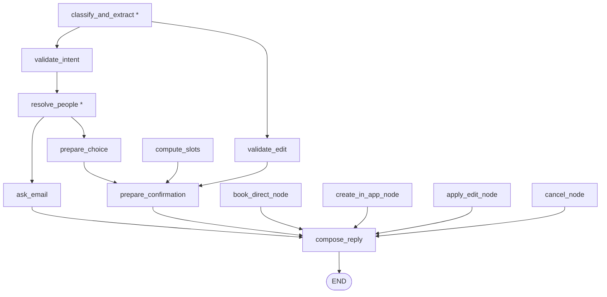

# agent_service — the When. chat agent

A standalone LangGraph package that powers the agentic chat drawer. It turns a
user's free-text message (or a structured button tap) into a deterministic
scheduling workflow: creating events, booking them directly onto calendars,
or editing an existing event.

The package lives next to `app/` inside `backend/` and is imported as a
top-level package (`from agent_service import graph`). Its single consumer is
`app/services/chat_service.py`, which runs one graph turn per request.

## Design principles

- **Deterministic routing.** The graph is a `StateGraph(AgentState)` whose
  every conditional edge is a plain Python lookup (`state['route']`). The LLM
  never decides control flow, never selects a slot, and never writes anything.
- **LLM confined to two nodes.** `classify_and_extract` (intent + field
  extraction) and `resolve_people` (name↔email pairing judgment). Everything
  else is pure deterministic logic — including `compose_reply`, which renders a
  fact-complete template per outcome (structured-action turns are 0-LLM).
- **Thinking disabled.** The model factory passes `thinking_budget=0` — the
  agent's calls are simple extraction/pairing tasks that gain nothing from
  Gemini 2.5 Flash's default dynamic thinking, which adds seconds per call.
  Keep `GEMINI_MODEL` on a Flash-tier model (Pro cannot disable thinking).
- **Security boundary at the entry router.** An event is only ever created,
  booked, or edited when the entry router dispatches a *structured action*
  (`confirm_draft` / `book_direct` / `use_in_app` / `cancel`) from a matching
  waiting state. Free text always routes to `classify_and_extract` first and
  can never reach a write node.
- **Stateless graph.** Each turn rehydrates workflow state from the
  `chat_threads` row, advances it, and `chat_service` writes it back. The graph
  itself holds no memory and never reads the wall clock —
  `reference_time_utc` is injected by the router.

## Module map

| Module | Role |
| --- | --- |
| `graph.py` | Graph construction + entry router. Exposes `get_compiled_graph()` (module-cached, real Gemini) and `build_graph(llm)` (tests inject a fake). |
| `state.py` | `AgentState` TypedDict — per-turn injected facts, rehydrated thread state, and turn outputs. |
| `nodes.py` | Create-workflow + shared nodes (validation, drafting, confirmation cards, booking dispatch). |
| `editing.py` | Edit-workflow nodes: `validate_edit` (before/after change set) and `apply_edit_node`. |
| `people.py` | Participant resolution: explicit email → profile lookup; bare name → co-participant directory; ambiguous name + stray email → one LLM pairing call. |
| `availability.py` | Deterministic slot ranking (reuses the proposal service's candidate grid) + best-effort busy-slot freshness sync. |
| `booking.py` | Write orchestration: `book_direct` (straight onto calendars via the hardened finalize path) and `create_in_app_event` (normal When. planning flow). |
| `llm.py` | Prompt builders, structured-output schemas (`ExtractedTurn`, `EmailPairing`), and the lazy Gemini model factory. |

## Graph topology

Structured actions dispatch straight from the entry router:

| Thread status | Action | Target node |
| --- | --- | --- |
| any | `cancel` | `cancel_node` |
| `awaiting_email` | `provide_email` / `pick_person` (or a bare email in free text) | `apply_email` |
| `awaiting_choice` | `book_direct` | `compute_slots` |
| `awaiting_choice` | `use_in_app` | `prepare_confirmation` |
| `awaiting_confirmation` | `confirm_draft` | `apply_edit_node` / `book_direct_node` / `create_in_app_node` (by workflow + booking mode) |
| anything else | — | `classify_and_extract` |

Free text flows through the LLM-backed pipeline (`*` = LLM node); every branch
fans into `compose_reply`, which renders the deterministic reply template for
the outcome and ends the turn:



## Time handling

- All persisted times are UTC (system invariant).
- The **browser's IANA timezone** rides along on every turn request
  (`ChatTurnRequest.timezone`, attached automatically by the frontend's
  `useSendChatTurn` hook) and is injected into the state as `user_timezone`.
  It is used only for display formatting and for converting extracted local
  windows to UTC, always via `app/utils/dates.py`.
- A missing or invalid timezone falls back to UTC (`dates._resolve_tz`).
- The LLM is anchored with "today + weekday + timezone" in the extraction
  prompt and always emits **local** dates/times; the graph converts to UTC.

## Running a turn

`chat_service.run_turn` builds the state dict (per-turn facts + rehydrated
thread row), calls `graph.get_compiled_graph().invoke(state)`, persists the
assistant message (`{"card": …, "buttons": […]}` jsonb), and writes the
advanced thread state back. Chat requires `GEMINI_API_KEY` (the settings'
`gemini_api_key` / `gemini_model`); without it the turn endpoint returns
`503 chat_disabled`.

## Testing

Tests never touch Gemini or Supabase: they call `build_graph(fake_llm)` with a
fake implementing `.with_structured_output(schema).invoke(...)`, and patch
`graph.get_compiled_graph` at the `chat_service` import site. Both names are
kept stable for that reason.

```bash
cd backend
venv/bin/python -m pytest tests/test_chat_graph.py tests/test_chat_service.py \
  tests/test_chat_people.py tests/test_chat_availability.py tests/test_chat_booking.py
```
